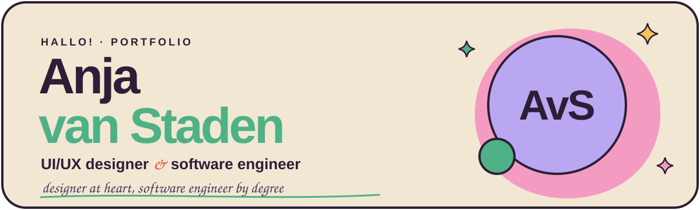
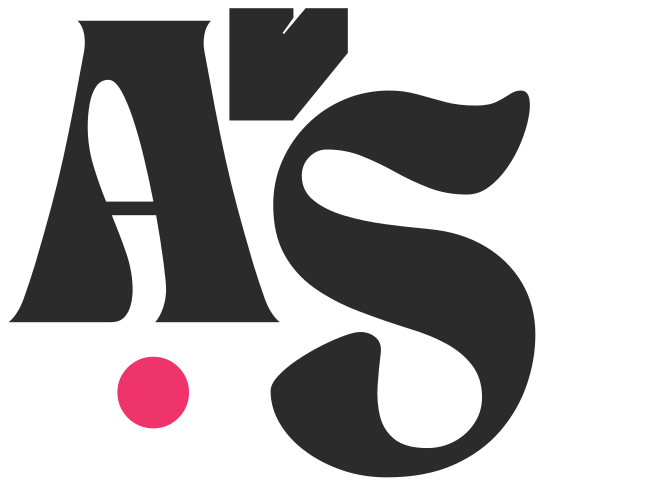

<div align="center">



<br />



### My personal portfolio, designed and built from scratch.

<em>Final-year Computer Science &amp; Operations Research student at Stellenbosch University</em>
<br />
<em>Proudly South African &amp; Dutch · open to work in Germany from 2027</em>

<br />
<br />

</div>

## Run it locally

> **You'll need** [Node.js](https://nodejs.org) **20.19+** or **22.12+**.

```bash
# 1. Install dependencies
npm install

# 2. Start the dev server with hot reload
npm run dev
```

Then open **http://localhost:5173** 


---

##  Project structure

```
├── public/
│   ├── favicon.svg          logo, also used in the navbar
│   └── profile.jpeg         hero photo
├── src/
│   ├── data/content.js      all site content
│   ├── pages/
│   │   ├── Home.jsx         hero, about, featured work, skills, contact
│   │   └── Projects.jsx     every project, galleries and lightbox
│   ├── components/          flags, doodles, titles and text-splitting helpers
│   ├── App.jsx              navbar, routing, theme toggle, scroll effects
│   ├── App.css              layout, components and animations
│   └── index.css            colour tokens, fonts, cursor and scrollbar
└── docs/banner.svg          the banner at the top of this README
```


<div align="center">

###  Let's talk 

[](mailto:anvnstaden@gmail.com)
[](https://github.com/anvnstaden)
[](https://www.linkedin.com/in/anja-van-staden)

<sub>Designed &amp; built by Anja van Staden in Stellenbosch</sub>

</div>
