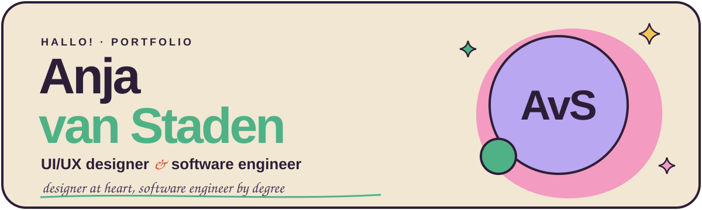
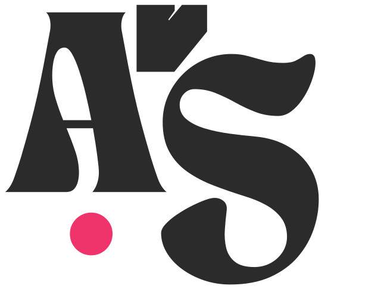

<div align="center">



<br />



### My personal portfolio, designed and built from scratch.

<em>Final-year Computer Science &amp; Operations Research student at Stellenbosch University</em>
<br />
<em>Proudly South African &amp; Dutch · open to work anywhere in the EU from January 2027, no visa needed</em>

<br />
<br />

</div>

## Run it locally

> **You'll need** [Node.js](https://nodejs.org) **20.19+** or **22.12+**.

```bash
# 1. Install dependencies
npm install

# 2. Start the dev server with hot reload
npm run dev
```

Then open **http://localhost:5173** 

## Tailored links

Without anything extra the site is about the whole EU. Add `?to=` to a link to point it at one country or city,
so each application gets its own link:

```
https://www.anjavanstaden.co.za/?to=amsterdam
https://www.anjavanstaden.co.za/?to=munich&lang=de
```

The hero stamp, the badge, the boarding pass, the About Me text and the last stop of the journey then name that
place, its postcard gets the country's flag and a greeting in the local language, and the letter is signed off in
it too. `&lang=de` opens the site in German. A link pointed at Germany (or the German version) also shows each
mark's German grade.

- **Countries:** `de` `at` `nl` `be` `ie` `fr` `es` `pt` `it` `dk` `se` `fi` `pl` `cz` `ee`
- **Cities:** `berlin` `munich` `hamburg` `frankfurt` `cologne` `dusseldorf` `stuttgart` `vienna` `amsterdam`
  `rotterdam` `utrecht` `the-hague` `eindhoven` `brussels` `antwerp` `dublin` `paris` `barcelona` `madrid`
  `lisbon` `porto` `milan` `copenhagen` `stockholm` `helsinki` `warsaw` `krakow` `prague` `tallinn`

Add more in `src/data/destinations.js`.


---

##  Project structure

```
├── public/
│   ├── favicon.svg          logo, also used in the navbar
│   └── profile.jpeg         hero photo
├── src/
│   ├── data/content.js      all site content
│   ├── data/destinations.js the countries and cities a tailored link can point at
│   ├── pages/
│   │   ├── Home.jsx         hero, about, featured work, skills, contact
│   │   └── Projects.jsx     university and personal projects, galleries and lightbox
│   ├── components/          flags, doodles, titles and text-splitting helpers
│   ├── App.jsx              navbar, routing, theme toggle, scroll effects
│   ├── App.css              layout, components and animations
│   └── index.css            colour tokens, fonts, cursor and scrollbar
└── docs/banner.svg          the banner at the top of this README
```


<div align="center">

###  Let's talk 

[](mailto:anvnstaden@gmail.com)
[](https://github.com/anvnstaden)
[](https://www.linkedin.com/in/anja-van-staden)

<sub>Designed &amp; built by Anja van Staden in Stellenbosch</sub>

</div>
